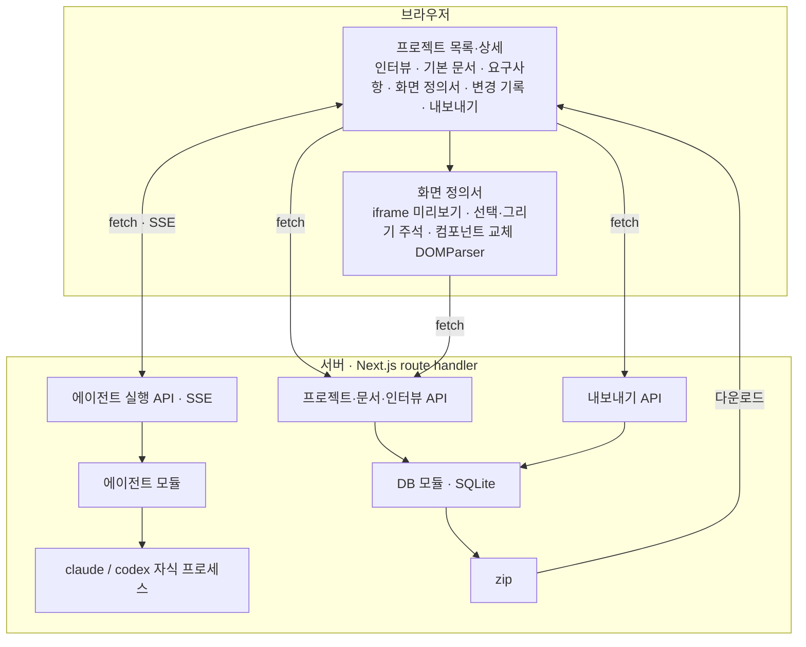

# 시스템 아키텍처

> 상태: 구현됨 — 자동 테스트·가짜 CLI 검증 완료. 실제 구독 로그인 검증은 남아 있다 ([changes/001-mvp.md](changes/001-mvp.md)).

## 기술 스택

| 영역 | 선택 | 이유 |
| --- | --- | --- |
| 앱 | Next.js (App Router), TypeScript | 화면과 서버 처리를 한 프로세스·한 명령으로 띄운다. |
| DB | SQLite (`better-sqlite3`) | 단일 사용자 로컬 앱이라 파일 하나로 충분하다. 동기 API라 코드가 단순하다. |
| 에이전트 | 로컬 `claude` CLI, `codex` CLI를 자식 프로세스로 실행 | 구독 로그인을 쓰는 유일한 방법이다. API 키를 쓰지 않는다. |
| 스트리밍 | Server-Sent Events | 서버→브라우저 단방향 출력이면 충분하다. |
| 문서 편집 | 마크다운 텍스트 편집 + 미리보기 | 문서가 마크다운이다. |
| 화면 정의서 | 스크립트를 막은 iframe 미리보기 + 브라우저 내장 `DOMParser` | 에이전트가 만든 HTML을 실행하지 않고 보여 주고, 컴포넌트 교체를 라이브러리 없이 한다. |
| 내보내기 | `jszip` | 승인 문서 세트를 `docs/` 구조 그대로 한 파일로 내려받는다. |

## 모듈 역할과 경계



- **페이지**: 화면과 입력만 맡는다. DB·CLI에 직접 접근하지 않는다. 예외로 화면 정의서의 HTML 정리·컴포넌트 교체는 브라우저가 한다 ([requirements/screens.md](requirements/screens.md#결과-반영)).
- **API**: 요청 검증, 생성 순서·동시 실행 규칙 검사, 모듈 호출.
- **DB 모듈**: 스키마 생성과 조회·저장. 테이블은 [3-DATABASE.md](3-DATABASE.md).
- **에이전트 모듈**: CLI별 어댑터(`claude`, `codex`)가 실행·상태 확인·로그인을 같은 형태로 제공한다. 동작 규칙은 [requirements/agent-cli.md](requirements/agent-cli.md), CLI별 실제 명령은 아래 [외부 연동](#외부-연동-에이전트-cli).
- **프롬프트**: 인터뷰와 문서 종류별 프롬프트, 화면 주석 요청 템플릿은 코드에 고정한다.
- **구현 경로**: 화면은 `src/app/`·`src/components/`, API는 `src/app/api/`, DB는 `src/server/db/`, CLI 어댑터는 `src/server/agents/`, 실행 잠금·종료 정리는 `src/server/runtime.ts`, 프롬프트는 `src/server/prompts.ts`에 있다.
- **문서 규칙**: 생성 프롬프트에 넣고 zip에 담는 문서 규칙은 이 저장소의 [`docs/AGENTS.md`](AGENTS.md)를 실행 시 그대로 읽는다. 사본을 따로 두지 않는다.

## 데이터 흐름

1. 사용자가 단계(인터뷰 또는 문서)와 에이전트를 고르고 실행한다.
2. API가 생성 조건을 확인하고 프롬프트를 조립한다. 들어가는 내용은 [requirements/documents.md](requirements/documents.md#생성-입력).
3. 에이전트 모듈이 CLI를 실행하고 출력을 SSE로 브라우저에 흘린다.
4. 완료되면 결과를 저장한다 — 마크다운 문서는 서버가, 화면 정의서는 브라우저가 정리 후 저장 API로. 인터뷰는 CLI 세션 ID를 저장해 다음 턴에 이어 간다.

## 외부 연동: 에이전트 CLI

2026-10-19에 Claude Code 2.1.303, codex-cli 0.162.1로 실제 실행해 확인한 값이다. CLI를 올리면 다시 확인하고 이 표를 갱신한다.

### 실행

| 항목 | Claude Code | Codex |
| --- | --- | --- |
| 실행 | `<CLAUDE_CLI> -p --output-format stream-json --verbose --include-partial-messages --tools "" --setting-sources "" --strict-mcp-config --session-id <uuid>` | `<CODEX_CLI> exec --json --sandbox read-only --skip-git-repo-check --ignore-user-config -C <작업 폴더> -` |
| 이어하기 | `--session-id` 대신 `--resume <uuid>` | `exec <같은 옵션> resume <thread_id> -` |
| 프롬프트 전달 | 표준입력 | 표준입력 (`-`) |
| 세션 ID | 시도마다 새 UUID를 만들어 `--session-id`로 지정하고, 첫 턴이 성공한 뒤 저장 | 첫 이벤트 `thread.started`의 `thread_id` (첫 턴 성공 뒤 저장) |
| 출력 조각 | `stream_event` → `content_block_delta`의 `delta.text` | 없음. 그 턴의 마지막 `item.completed`(`item.type = agent_message`)가 전체 본문 |
| 최종 결과 | `type: result` — `result`, `is_error`, `session_id` | `turn.completed` (실패는 `turn.failed` / `error`) |
| 도구·명령 | `--tools ""`로 도구 0개 (명령 실행·파일 접근 없음) | read-only sandbox — 파일 쓰기는 막히지만 읽기 명령은 실행될 수 있다 |
| 사용자 설정·지시문 | `--setting-sources "" --strict-mcp-config`로 사용자 훅·플러그인·MCP와 전역 `~/.claude/CLAUDE.md`가 빠진다 (내장 플러그인만 남음) | `--ignore-user-config`만으로는 전역 `~/.codex/AGENTS.md`가 들어간다. 그래서 `CODEX_HOME`을 앱 전용 폴더로 둔다 (아래 실행 환경) |

- **`--bare`는 쓰지 않는다.** OAuth를 읽지 않아 구독 로그인이 동작하지 않는다.
- Codex의 `--sandbox` 등 `exec` 옵션은 `resume` 턴에도 적용된다 (이어하기 턴에서 파일 생성 시도가 막힘을 확인).
- 표준입력을 닫지 않으면 두 CLI 모두 입력을 기다린다. 프롬프트를 쓰고 바로 닫는다.
- 두 CLI 모두 작업 폴더에 파일을 만들지 않았다.

### 실행 환경

- **작업 폴더**: 모든 자식 프로세스는 `<데이터 폴더>/agent-workdir`(빈 폴더, 고정)에서 실행한다. SDDMaker 저장소에서 실행하면 CLI가 SDDMaker의 `AGENTS.md`·`docs/`를 지시로 읽어 생성 문서가 오염된다. Claude 세션은 작업 폴더 기준으로 저장되므로 폴더를 바꾸지 않는다.
- **CLI 홈 분리**: Claude는 `CLAUDE_CONFIG_DIR=<데이터 폴더>/claude-home`, Codex는 `CODEX_HOME=<데이터 폴더>/codex-home`으로 실행한다. 로그인·상태 확인·생성 모두 같은 경로를 쓰며 상속된 전역 홈 설정은 덮어쓴다. 두 CLI 모두 SDDMaker에서 별도로 로그인하며, 호스트의 로그인 파일을 복사하거나 마운트하지 않는다 ([changes/003-isolated-login.md](changes/003-isolated-login.md)). Claude의 macOS Keychain 항목도 설정 디렉터리별로 구분되며, Linux에서는 전용 폴더의 `.credentials.json`에 저장한다. Codex는 이 폴더를 사용해 사용자 전역 `~/.codex/AGENTS.md`도 분리한다.
- **API 키·다른 경로 제거**: 자식 프로세스 환경에서 `ANTHROPIC_API_KEY`, `ANTHROPIC_AUTH_TOKEN`, `CLAUDE_CODE_OAUTH_TOKEN`, `OPENAI_API_KEY`, `CODEX_API_KEY`, `CODEX_ACCESS_TOKEN`, `ANTHROPIC_BASE_URL`, `CLAUDE_CODE_USE_BEDROCK`, `CLAUDE_CODE_USE_VERTEX`, `OPENAI_BASE_URL`을 지운다. 호스트의 인증 토큰이나 다른 과금 경로가 전용 구독 로그인보다 우선하지 않도록 한다.
- **셸 미사용**: 실행 파일을 직접 실행한다(`spawn`, 셸 없음).

### 로그인 상태·로그인

| 항목 | Claude Code | Codex |
| --- | --- | --- |
| 상태 확인 | `auth status` — JSON. 로그인: `loggedIn: true`, `authMethod: "claude.ai"`(구독). 미로그인: `loggedIn: false`, `authMethod: "none"` | `login status` (`CODEX_HOME` 지정) — 로그인: `Logged in using ChatGPT`, 종료 코드 0. 미로그인: `Not logged in`, 종료 코드 1 |
| 로그인 | `auth login --claudeai` (구독, 브라우저가 열림) | `login --device-auth` (`CODEX_HOME` 지정, URL·코드 출력) |
| 터미널 로그인 안내 | `CLAUDE_CONFIG_DIR='<데이터 폴더>/claude-home' claude auth login --claudeai` | `CODEX_HOME='<데이터 폴더>/codex-home' codex login --device-auth` |

- 두 CLI의 stdout·stderr를 SSE로 전달해 웹 로그인 콘솔에서 보여 준다. 두 CLI 모두 로그인 동안 stdin을 열어 두고 세션 식별자를 확인한 콘솔 입력을 한 줄씩 전달한다. Enter는 입력 전송, Ctrl+C는 로그인 취소다. Claude 간편 코드 제출은 전체 반환 코드 한 줄을 전달한 뒤 stdin을 닫는다. CLI 2.1.303은 PTY 없이 pipe에서 입력을 받으며, 개행 없는 프롬프트도 출력 조각 단위로 전달한다. Codex는 기기 인증 URL·코드를 보여 주고 브라우저 인증을 기다린다 ([changes/004-login-console.md](changes/004-login-console.md), [changes/005-console-input.md](changes/005-console-input.md)). Codex 기기 코드 로그인은 ChatGPT 보안 설정에서 허용해야 하며 기기 코드는 브라우저에 입력한다. 실제 계정 인증·모델 생성은 별도 검증이다.
- 앱은 자체 OAuth를 구현하지 않고 토큰을 다루지 않는다 ([requirements/agent-cli.md](requirements/agent-cli.md#규칙)).

## 보안

- 호스트 개발 서버는 `127.0.0.1`에만 연다. 컨테이너 내부 서버는 포트 전달을 위해 `0.0.0.0`에서 받고, Docker의 호스트 포트는 `127.0.0.1`에만 공개한다. 인증 없는 API가 사용자 구독으로 CLI를 실행하므로 같은 네트워크에 열면 안 된다.
- 모든 요청은 `Host`가 `localhost`/`127.0.0.1`일 때만 받는다 (DNS rebinding으로 문서 본문을 읽는 것을 막음). 변경 요청(POST·PUT·DELETE·PATCH)은 `Origin`이 있어야 하며, 그 호스트와 포트가 `Host`와 같아야 한다. 다른 로컬 포트와 `localhost`↔`127.0.0.1` 혼용도 거부한다.
- `<데이터 폴더>`에는 DB와 SDDMaker용 CLI 로그인 파일이 있다. git에 올리거나 공유하지 않는다.

## 서버 공유 상태

프로젝트별 실행 잠금과 실행 중인 자식 프로세스 목록은 여러 API(생성·취소·프로젝트 삭제)가 함께 쓴다. 개발 서버가 모듈을 다시 읽어도 사라지지 않게 `globalThis`에 둔다.

CLI는 별도 프로세스 그룹으로 실행한다. 취소·연결 끊김·시간 초과 시 그룹에 SIGTERM을 보내고 2초 뒤에도 남으면 SIGKILL로 정리한다. 부모 CLI가 끝나도 그룹에 남은 프로세스는 정리한다. 서버의 SIGINT·SIGTERM 종료에서는 1초 유예 후 그룹을 정리하고, `exit`에서는 즉시 정리한다.

인터뷰·문서 생성 한 번의 상한은 10분이다. 시간 초과는 `agent_failed`와 `응답 시간이 초과되었습니다` 메시지로 전달하며 부분 결과를 저장하지 않는다.

## 실행·테스트

| 용도 | 명령 |
| --- | --- |
| 개발 실행 | `npm run dev` (= `next dev -H 127.0.0.1`) |
| 테스트 | `npm test` (= `vitest run`) |
| 린트 | `npm run lint` (= `eslint .`) |
| 타입 검사 | `npm run typecheck` (= `tsc --noEmit`) |
| 빌드 | `npm run build` (= `next build`) |

| 환경변수 | 용도 | 기본값 |
| --- | --- | --- |
| `CLAUDE_CLI` | Claude Code 실행 파일의 절대 경로. 인자를 넣지 않는다 | `claude` (PATH에서 찾음) |
| `CODEX_CLI` | Codex 실행 파일의 절대 경로. 인자를 넣지 않는다 | `codex` (PATH에서 찾음) |
| `SDDMAKER_DATA_DIR` | DB 파일(`sddmaker.db`), CLI 작업 폴더(`agent-workdir/`), Claude 홈(`claude-home/`), Codex 홈(`codex-home/`)을 둘 폴더 | `./data` |

- 환경변수는 `.env.local`에 둔다. 셸 alias는 자식 프로세스에 적용되지 않으므로, `claude`를 alias로 쓰는 환경(예: `npx @anthropic-ai/claude-code`)은 Claude Code를 전역 설치하고 그 경로를 `CLAUDE_CLI`에 넣는다.
- `./data/`는 git에서 제외한다.
- 비밀값은 기록하지 않는다 (MVP는 API 키를 쓰지 않는다).

## Docker·Docker Compose 실행

로컬 실행 전용이며 외부 배포는 하지 않는다 ([0-PRODUCT.md](0-PRODUCT.md#제품-공통-정책)). Docker는 호스트 설치를 대신하는 실행 방법이다 ([changes/002-docker.md](changes/002-docker.md)).

`Dockerfile`은 Node.js 24 Debian bookworm 기반의 다단계 빌드다. Linux 환경에서 `npm ci`와 Next.js standalone 빌드를 수행하므로 호스트의 `node_modules`나 SQLite 네이티브 모듈을 복사하지 않는다. 런타임에는 standalone 서버·정적 파일·`docs/AGENTS.md`와 Claude Code 2.1.303·Codex 0.162.1을 넣고 `node` 사용자로 실행한다. CLI 자동 업데이트는 끈다. 버전 변경 시 어댑터·로그인·sandbox 호환성을 다시 확인한다.

```sh
docker compose up -d --build --wait
docker compose logs -f sddmaker
docker compose down
```

기본 접속 주소는 `http://127.0.0.1:3000`이다. 호스트 포트만 바꾸려면 `SDDMAKER_PORT=3001 docker compose up -d --wait`를 쓴다. Compose는 init 프로세스, 상태 검사, 10초 종료 유예를 설정한다. 상태 검사는 SQLite를 읽는 `GET /api/projects`의 성공 여부를 확인한다.

Docker만 사용할 때:

```sh
docker build -t sddmaker:local .
docker run -d --name sddmaker --init \
  -p 127.0.0.1:3000:3000 \
  -v sddmaker-data:/app/data \
  -v sddmaker-cli-home:/home/node \
  sddmaker:local
docker stop sddmaker
```

| 컨테이너 경로 | 보관 내용 | Compose 볼륨 |
| --- | --- | --- |
| `/app/data` | SQLite, 고정 작업 폴더, 앱 전용 Claude·Codex 홈·로그인 | `data` |
| `/home/node` | 그 밖의 CLI 홈 파일·캐시 | `cli-home` |

볼륨 이름에는 Compose 프로젝트 접두사가 붙는다. 호스트의 `./data`, `~/.claude`, `~/.codex`는 자동으로 공유하지 않는다. 컨테이너 재생성·`down` 후에도 볼륨은 남는다. `docker compose down -v` 또는 해당 Docker 볼륨 삭제는 DB와 로그인까지 지운다. `.dockerignore`는 로컬 데이터·환경변수·Git·빌드·작업 기록을 이미지 빌드에서 제외한다.

컨테이너 안에서 처음 한 번 계정 인증이 필요하다. 앱의 **계정 연결**에서 인증 페이지를 열고, Claude의 반환 코드는 앱에 붙여넣거나 Codex의 기기 코드는 인증 페이지에 입력한다. 터미널에서 직접 인증하려면:

```sh
docker compose exec sddmaker claude auth login --claudeai
docker compose exec sddmaker codex login --device-auth
```

Docker만 쓴다면 `docker compose exec sddmaker` 대신 `docker exec -it sddmaker`를 쓴다. URL은 이용 중인 브라우저에서 열고, Claude가 반환 코드를 요구하면 같은 터미널에 입력한다. 이미지의 `CLAUDE_CONFIG_DIR=/app/data/claude-home`과 `CODEX_HOME=/app/data/codex-home`이 앱과 터미널에서 같으므로 컨테이너 인증이 앱에 반영된다. 호스트에 두 CLI나 로그인 정보가 없어도 인증을 시작할 수 있다. 로그인을 마치면 앱에서 상태를 새로 확인한다. 앱은 API 키 방식으로 대체하지 않는다.

Claude는 콜백에 접근할 수 없는 환경에서 반환 코드를 요구할 수 있다. 앱 입력칸은 전체 `code#state`를 같은 로그인 CLI로 전달한다. 직접 로그인할 때는 위 대화형 명령의 터미널에 입력한다. 기존 `/home/node/.claude` 또는 호스트 기본 Claude 로그인은 새 전용 저장소로 자동 이동하지 않는다. 기존 파일을 삭제하지 않으며 새 경로에서 한 번 다시 인증한다.

인증 격리 근거: [Claude 계정별 설정 디렉터리](https://code.claude.com/docs/en/authentication#log-in-with-multiple-accounts), [Codex 인증 저장소](https://learn.chatgpt.com/docs/auth#credential-storage).

Codex의 Linux read-only sandbox는 Docker 호스트의 namespace·seccomp 정책에 따라 실행이 제한될 수 있다. 이번 Docker Desktop 검증에서는 실제 sandbox 명령이 bubblewrap namespace 권한 오류로 실패했다. 컨테이너에도 기존 `--sandbox read-only`를 유지하며, privileged 모드나 권한 우회는 기본 구성에 넣지 않는다. 이 환경에서는 Claude를 사용하거나 Codex를 호스트 실행에서 사용한다. 실제 구독 인증·모델 생성은 이미지 기동·가짜 CLI 검증과 별도다.

구성 근거: [Next.js standalone 출력](https://nextjs.org/docs/app/api-reference/config/next-config-js/output), [Claude 컨테이너 로그인](https://code.claude.com/docs/en/authentication#log-in-to-claude-code), [Codex 헤드리스 로그인](https://learn.chatgpt.com/docs/auth#login-on-headless-devices), [Codex 컨테이너 sandbox](https://learn.chatgpt.com/docs/agent-approvals-security#run-codex-in-dev-containers).
